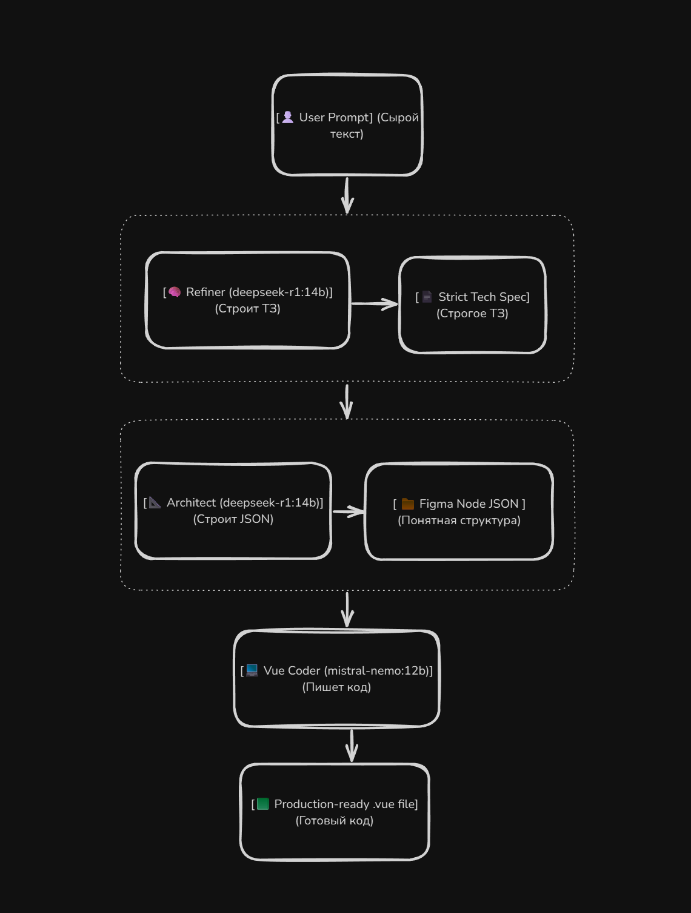

# ai-component-workshop

AI-powered UI generator. Transforms raw text prompts or Figma nodes into production-ready Vue 3 + Tailwind components using a multi-agent LLM pipeline.

## 🚀 Features

- **Multi-Agent Pipeline:** Refiner -> Architect -> Vue Coder.
- **Figma Integration:** Fetch node structures directly by ID or SVG reference.
- **Local & Private:** Runs entirely on your hardware via Ollama.
- **Live SSE Streaming:** Real-time generation progress in the UI.

---

## 🛠️ Requirements

* **Python:** Python 3.11+ (или 3.10 с пакетом tomli).
- **Ollama:** Установленный и запущенный [Ollama](https://ollama.com/) с моделями.
- **Node.js / Vite (Опционально):** Если планируете дорабатывать фронтенд (в текущей версии фронтенд на чистом HTML/JS).

---

## 📦 Installation

### 1. Клонируйте репозиторий

```bash
git clone https://github.com/NekitSan/ai-component-workshop.git
cd ai-component-workshop
```

### 2. Установите системные зависимости (для Linux/WSL)

В некоторых дистрибутивах (например, Ubuntu) модуль venv не идет из коробки. Если вы на Windows, этот шаг можно пропустить.

_(Для Linux/WSL: если команда `venv` не найдена, установите пакет: `sudo apt install python3-venv -y`)_

```bash
sudo apt update
sudo apt install python3-venv python3-pip -y
```

### 3. Создайте и активируйте виртуальное окружение

```bash
python3 -m venv .venv
source .venv/bin/activate  # Для Linux/Mac/WSL
# или .venv\Scripts\activate для Windows
```

### 4. Установите зависимости

```bash
pip install -r requirements.txt
```

---

## 🖥️ System Requirements

Для комфортной работы проекта (запуск двух локальных LLM) ваш компьютер должен обладать достаточным объемом оперативной памяти и VRAM.

### Minimum (Запустится, но будет медленно)

- **OS:** Windows 10/11 (с WSL2), Linux или macOS.
- **RAM:** 16 GB (система + одна модель).
- **VRAM (GPU):** 8 GB (для квантованных моделей).
- **Disk:** ~20 GB свободного места (Ollama + модели).

### Recommended (Для комфортной разработки)

- **RAM:** 32 GB+.
- **VRAM (GPU):** 12–16 GB (например, RTX 3060 12GB, RTX 4070).
- **Disk:** SSD NVMe для быстрой загрузки моделей.

---

## 🧠 Recommended Models

Проект использует **две модели**:

1. **Архитектор** (в `.env` указывается первой) — пишет ТЗ (Агент 0) и проектирует структуру Figma (Агент 1).
2. **Кодер** (вторая модель) — переводит структуру в Vue 3 + TypeScript (Агент 2).

Указать их можно в `.env` через запятую: `MODELS=модель_архитектора,модель_кодера`

### Вариант 1: Баланс (Рекомендуемый)

- **Архитектор:** `deepseek-r1:14b` (Q4_K_M ~8 GB) — отлично следует инструкциям и генерирует сложные JSON.
- **Кодер:** `mistral-nemo:12b` (Q4_K_M ~8 GB) — хорошо знает Vue 3 и TypeScript.

### Вариант 2: Легкий (Для слабых ПК / 8 GB VRAM)

- **Архитектор:** `deepseek-r1:7b` (~5 GB) или `qwen2.5-coder:7b`
- **Кодер:** `qwen2.5-coder:7b` (~5 GB)

### Вариант 3: Качество (Для мощных ПК / 16+ GB VRAM)

- **Архитектор:** `deepseek-r1:14b` (Q5 или Q8)
- **Кодер:** `mistral-nemo:12b` (Q5 или Q8)

---

## ⚙️ Configuration

Перед запуском необходимо настроить два файла.

### 1. `.env` (Секреты и модели)

Скопируйте `.env.example` в `.env` и заполните:

**Никогда не коммитьте файл .env в репозиторий. Убедитесь, что он в .gitignor**

```inie
FIGMA_TOKEN=your_figma_personal_access_token
FIGMA_FILE_KEY=your_file_key
FIGMA_BASE_URL=https://api.figma.com/v1/files/

OLLAMA_API_URL=http://localhost:11434/api/chat
# Первая модель - Архитектор (ТЗ + Figma). Вторая модель - Кодер (Vue).
MODELS=deepseek-r1:14b,mistral-nemo:12b
```

### 2. `config.toml` (Параметры ИИ)

Здесь настраиваются `temperature`, `num_predict`, `keep_alive` для каждого агента:

```toml
[ollama.global]
stream = false
format = "json"
default_keep_alive = 0

[ollama.agents.refiner]
# Использует MODELS[0] (Редактор)
keep_alive = 0
temperature = 0.1
num_predict = 1024
num_ctx = 8192

[ollama.agents.architect]
# Использует MODELS[0] (Архитектор)
keep_alive = "5m"
temperature = 0.2
num_predict = 2048
num_ctx = 8192

[ollama.agents.vue]
# Использует MODELS[1] (Кодер)
keep_alive = "5m"
temperature = 0.1
num_predict = 4096
num_ctx = 8192
```

---

## 🏃‍♂️ Running the App

Запустите сервер через единую точку входа:

```bash
python run.py
```

После успешного старта откройте в браузере:
👉 **<http://localhost:5555/>**

---

## 🧪 Running Tests

Для проверки конфигурации и логгера:

```bash
pytest
```

---

## 🏗 Архитектура пайплайна (Multi-Agent System)

Проект использует подход «Разделяй и властвуй» (Divide and Conquer). Вместо того чтобы заставлять одну огромную модель делать всё сразу, задача разбивается на три специализированных этапа (агента):

<picture>
  <source media="(prefers-color-scheme: dark)" srcset="./docs/pipeline_architecture_dark.png">
  <source media="(prefers-color-scheme: light)" srcset="./docs/pipeline_architecture_light.png">
  
</picture>

1. 🧠 **Refiner (DeepSeek)** — _Аналитик._
    - **Что делает:** Получает сырой, "человеческий" запрос от пользователя (или JSON из Figma) и строит на его основе строгое, структурированное Техническое Задание (ТЗ).
    - **Зачем нужен:** Убирает двусмысленность. Переводит "хотелки" на язык инженерных требований.

2. 📐 **Architect (DeepSeek)** — _Проектировщик._
    - **Что делает:** Берет готовое ТЗ и проектирует структуру будущего компонента. На выходе получается чистый, валидный JSON-файл с иерархией слоев, пропсами и структурой.
    - **Зачем нужен:** Отделяет логику от верстки. Модель думает о геометрии и структуре, не отвлекаясь на синтаксис Vue.

3. 💻 **Vue Coder (Mistral)** — _Инженер-программист._
    - **Что делает:** На основе ТЗ и JSON-структуры (от Архитектора) пишет production-ready код.
    - **Зачем нужен:** Генерирует строго типизированный компонент (TypeScript, `<script setup>`, `v-model`), соблюдая все правила и стили, заложенные в системный промпт.

4. 📦 **Vue Component** — _Результат._
    - **Что делает:** Отдает готовый, отформатированный код в UI для копирования и использования в вашем проекте.

---

## 📂 Project Structure

```text
├── app/
│   ├── agents/          # ИИ-агенты (refiner, architect, vue)
│   ├── llm/             # Промпты, статусы, примеры (JSON)
│   ├── utils/           # Логгер, очистка JSON
│   ├── config.py        # Загрузка .env + TOML
│   └── routes.py        # Flask эндпоинты и SSE
├── .env.example
├── config.toml
├── run.py               # Точка входа
└── requirements.txt
```

---

> **Note on development history:**
>
> _Проект создавался в формате R&D (Research and Development). Так как это пет-проект, я не вел строгую историю коммитов с самого начала, чтобы не тратить время на Git-рутину. Однако полная история итераций, архитектурных решений и решенных баг-кейсов зафиксирована в файле [CHANGELOG](./docs/CHANGELOG.md)._

## 📝 License

MIT
